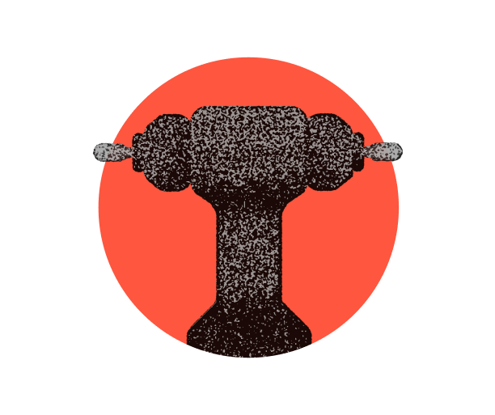
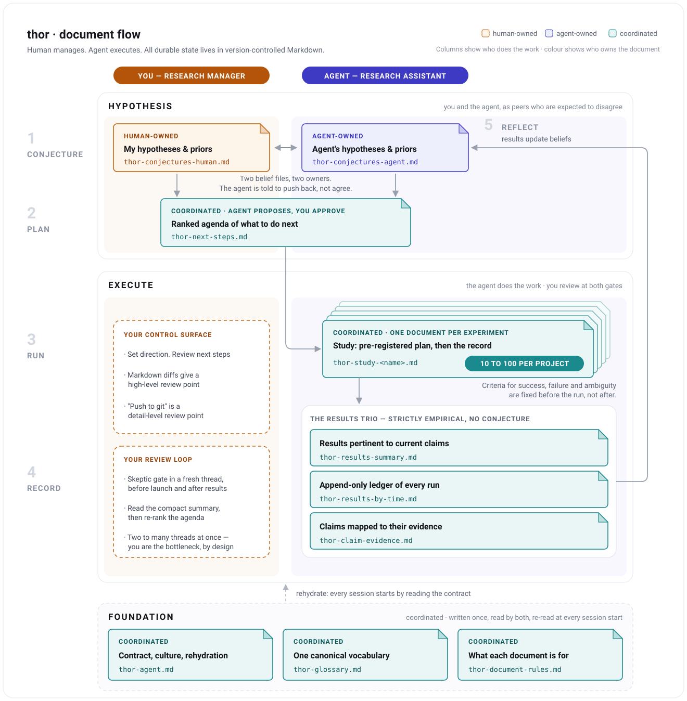
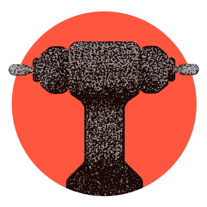

<h1 align="center">thor: Towards Human-Oracle Research</h1>

<p align="center">
  <a href="https://github.com/withmartian/thor/blob/main/LICENSE"></a>
</p>

<p align="center">
  
</p>

**A small set of Markdown templates, plus a working practice, for running real
research with AI agents as semi-independent assistants.**

It is built for **open-ended, multi-week research** — the kind where you begin
with an area, a direction, and a few clues, but the destination is unknown and
your starting hypothesis is probably wrong. Unlike software, there is no test for
"done", and no oracle to tell you whether today moved you closer.

The core idea is **positive disagreement.** Because nothing external tells you
when a hypothesis is wrong, the real danger is over-believing it — yours or the
agent's — for weeks. So thor keeps the human and the agent as peers who are
*expected* to disagree: neither is an oracle alone, but working well together
they get closer to the truth than either could. It records
both sets of beliefs in separate files, biases experiments toward ones that
settle the difference, and runs a fresh **skeptic** at the gates required by the
project's experiment policy.
Writing everything down is the substrate that makes this work.

> **New here?** Read the [long-form write-up](docs/blog.md) — *doing great
> research with AI agents that disagree with me* — then clone the
> [templates](templates/). See thor at work in [four real projects](EXAMPLES.md).



## Why a method at all?

An AI research agent's working memory is wiped on every crash, compaction, vendor
swap, or reboot. So the durable memory of the project must live in
version-controlled Markdown, not in the agent's head. Every session begins with a
**rehydration** step ("read `thor-agent.md`"). Every document has one clear
purpose and one clear owner — you or the agent. Because all state is in the docs,
thor is model- and vendor-agnostic; it has been run with Claude, ChatGPT, and
OpenCode.

## The four ideas

- **Positive disagreement.** Human and agent keep *separate* belief files and are
  encouraged to disagree. Experiments are biased toward ones that *discriminate*
  between competing conjectures rather than confirm whoever spoke first.
- **Write it down.** All durable state lives in the Markdown docs, so it survives
  crashes, vendor swaps, reboots, and a collaborator joining by `git clone`.
- **Skeptic gates.** Gated studies get two reviews by default — before launch
  (is the plan sound?) and after results (is the verdict over-claimed?) — in a
  *separate context* that rehydrates from docs and artifacts. Configured low-cost
  exploration can guide the next run without gates; rerun at a gated tier before
  a claim or other evidence-bearing decision rests on it. Projects define their
  own limits and explicit overrides in the agent contract.
- **Be a manager.** Agents are fast, cheap, knowledgeable research *assistants* —
  not scientists. They lack research taste and get tunnel vision. Set direction,
  review the Markdown diff, and keep a human in the loop.

## The templates

Framework docs are named `<prefix>-<role>.md` so they form a visible group
instead of scattering among ad-hoc docs.

### Per-topic docs (prefix = `thor`, or the topic name in a multi-topic project)

| Template | Role | Owner |
| --- | --- | --- |
| [thor-agent.md](templates/thor-agent.md) | Rehydration + operating contract; entry point | human |
| [thor-conjectures-human.md](templates/thor-conjectures-human.md) | Human's priors and beliefs | human |
| [thor-conjectures-agent.md](templates/thor-conjectures-agent.md) | Agent's priors and beliefs | agent |
| [thor-next-steps.md](templates/thor-next-steps.md) | Ranked agenda of what to do next | coordinated topic doc |
| [thor-results-summary.md](templates/thor-results-summary.md) | Current best story, compact | coordinated topic doc |
| [thor-results-synthesis.md](templates/thor-results-synthesis.md) | Mid-level empirical synthesis, organised by question | coordinated topic doc |
| [thor-results-by-time.md](templates/thor-results-by-time.md) | Append-only chronological results ledger | coordinated topic doc |
| [thor-claim-evidence.md](templates/thor-claim-evidence.md) | Durable claims and their supporting evidence | coordinated topic doc |

### Project-wide docs (always `thor-`, one per project)

| Template | Role | Owner |
| --- | --- | --- |
| [thor-document-rules.md](templates/thor-document-rules.md) | What each doc is for and how to update it | human |
| [thor-glossary.md](templates/thor-glossary.md) | Single canonical vocabulary (anti-drift) | project-wide shared across topics |
| [thor-study-template.md](templates/thor-study-template.md) | Shared master for per-study plans and records | human; copy into the active topic's study folder |

### Naming convention

The two tables above split the docs into **per-topic** (duplicated once per
thread) and **project-wide** (a single shared instance). That split is the whole
naming rule:

- **Single-topic project:** keep the `thor-` prefix everywhere and use the files
  exactly as shipped — no renaming.
- **Multi-topic project:** copy the *per-topic* docs once per thread and replace
  `thor` with the thread's name (`maths-agent.md`, `maths-conjectures-human.md`,
  …; `paper-agent.md`, …). The **project-wide** docs are *not* copied — keep
  one `thor-document-rules.md`, one `thor-glossary.md` and one
  `thor-study-template.md`, still `thor-`-prefixed, shared across every thread.

So a project with a `maths` research thread and a `paper` write-up thread carries
a set of `maths-*` docs, the applicable `paper-*` docs, and the shared rules,
glossary and study template. A publication-only topic needs its own workflow,
not an experimental doc set merely to fill the template. Keep `thor-agent.md`
as the repo-wide router and thread registry; topic contracts link to its shared
tier policy and add their own scope, config and explicit exceptions.

## Start a new project

1. Copy the [`templates/`](templates/) folder into your project (e.g. as `docs/`).
2. Fill in `docs/thor-agent.md` first: goal, scope, ownership, resource limits and
   [experiment tiers](templates/thor-agent.md#experiment-tiers). Set a per-run
   exploratory budget to enable ungated pilots; otherwise non-trivial experiments
   use the default full study note and two reviews. Routine docs and deterministic
   software checks that make no research claim need neither.
3. Seed `thor-conjectures-human.md` with your real starting beliefs (expect them
   to be wrong).
4. List a few first experiments in `thor-next-steps.md`.
5. Install the harness entrypoint below, then start an agent with:
   *"Read `docs/thor-agent.md`. Proceed per the contract."*

For a multi-topic project, repeat steps 2–4 per thread (replacing `thor` with the
thread name on the per-topic docs). Replace references to per-topic docs as well
as filenames; retain shared `thor-` references. Fill the registry in the repo-wide
router, and start each agent with its topic assignment: *"You are working on
`maths`. Read `docs/thor-agent.md`, then `docs/maths-agent.md`."*

Copy study notes into `docs/study-<topic>/` (use `study-thor/` for a single-topic
project). Adjust their shared-doc links to `../thor-document-rules.md`, and point
the tier-policy link at the canonical agent contract. Deeper folders need another
`../`. Check links after copying or renaming; the template's sibling links work
in `templates/`, not automatically in every destination.

### Connect the harness entrypoint

For harnesses that read `AGENTS.md`, put this short pointer in the repository root.

```markdown
Read `docs/thor-agent.md` first and follow its Rehydration steps for this task.
For multi-topic work, read the assigned topic's contract from its thread registry.
```

Keep the operating rules in their canonical docs rather than copying them into
each harness entrypoint. Check the harness's actual context-loading behavior;
a linked Markdown file is not automatically loaded just because it exists.

In a fresh session, ask the agent to identify its entry contract, applicable tier
policy and task-specific next reads without changing files. Check the loaded
context or read-tool trace, not only its assertion that it read the rules. Repeat
after a harness change or a broken rehydration route.

Optionally, mark the project as a thor project so a collaborator — or you, six
weeks later — can see which practice the docs belong to. Paste this into your own
README:

```markdown
[ uses thor](https://github.com/withmartian/thor)
```

## The twelve practices behind the templates

1. **Document-first memory.** All context the agent needs lives in the MDs.
2. **Rehydration ritual.** Every session starts by reading `thor-agent.md`.
3. **Positive disagreement (peer conjecture docs).** Human and agent keep
   *separate* belief docs and are encouraged to disagree; bias experiments toward
   ones that discriminate between them rather than confirm whoever spoke first.
4. **Pre-registered studies.** Each `thor-study-*.md` states success/failure
   criteria *before* the run and states competing reads neutrally rather than as
   advocacy for the desired answer.
5. **Empirical/speculative separation.** Results docs never argue conjecture;
   conjecture docs never smuggle in results.
6. **Anti-drift glossary.** One shared `thor-glossary.md` per project; new terms
   must be defined and used consistently in code, notes, and plots.
7. **One thread per topic.** For multi-topic projects, give each topic its own
   `<topic>-agent.md` and its own agent, with isolated ownership, sharing the
   project-wide docs. Declare the topics and their scope boundaries in a thread
   registry, and never fork a project-wide doc per topic.
8. **Verified negatives.** Every assay carries a positive control and an honest
   power statement; a flat result only counts as negative if the harness
   demonstrably could have detected the effect.
9. **Scored predictions.** Score relevant predictions confirmed/refuted/untouched
   in the study record. Empirical belief updates follow the applicable review
   policy; agents update their own conjectures and propose human-file revisions
   to the owner.
10. **Depth budgets and the outside view.** A line that runs past its depth budget
    without updating a conjecture pauses by default unless the next study records
    a justification. A freeze follows the evidence/review rules and classifies
    itself (question answered / question failure / instrument failure). Instrument
    failure requires a literature sweep for isomorphic problems before the next
    experiment — so the project re-reads the world, not only itself.
11. **Skeptic gates.** Select the experiment tier before launch and run its required
    reviews in a separate context. A self-check is not a skeptic gate. Record the
    actual review and resolutions in the study note. A different model or vendor
    is encouraged, not required. Gate requirements and exploratory exceptions
    live in the agent contract.
12. **Context isolation.** Planning, review, execution, result recording and
    router-doc updates are distinct phases. Reviewers rehydrate from declared docs
    and artifacts, not the working session's conversation. A research *thread* is
    a topic; an *agent session* is a context; a *workstream* is an owned unit of work.

> Adapt freely. The templates serve the work, not the other way around.

## Read more

- **Long-form:** [doing great research with AI agents that disagree with me](docs/blog.md)
- **Short-form:** [LinkedIn teaser](docs/linkedin.md) · [X thread](docs/x-thread.md)
- **In practice:** [thor in the wild](EXAMPLES.md) — intent, quanta_maths,
  scaling-laws, Wayfinder

## Status

thor is a snapshot of a live practice, not a finished system — the templates and
the write-ups keep improving. Treat everything here as a recommended default to
adapt, not a standard to obey.

## Contributing & contact

Improvements are welcome, and I would especially like to hear what broke when you
tried it. thor is curated by **Philip Quirke** (Martian); please propose changes
by getting in touch rather than opening a pull request — see
[CONTRIBUTING.md](CONTRIBUTING.md).

## License

[MIT](LICENSE). Free to copy, adapt, and use.
